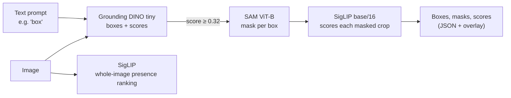
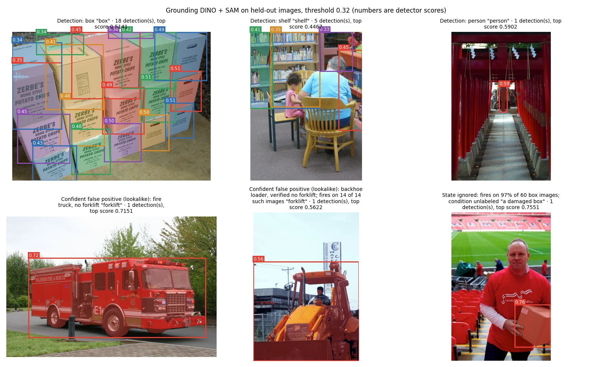

# Warehouse Inspection: Production Readiness and Operational Risk

This document is for people deciding whether, and how, to use this open-vocabulary warehouse inspection system, which finds and segments warehouse objects described in plain language without retraining for each new item. It states what the system does well, how and how often it fails, and what has not been measured, so that operational risks can be weighed against benefits. Detailed methods are in [RESULTS.md](RESULTS.md); the review history is in [REVIEW.md](REVIEW.md); binding safety requirements are in [DESIGN_DECISIONS.md](DESIGN_DECISIONS.md#safety-requirements).

**Bottom line.** The system is a zero-shot research prototype (Grounding DINO for boxes, SAM for masks, SigLIP for scoring), evaluated on Open Images photographs, not warehouse cameras. It finds new object types from a prompt alone, which is its benefit, but it fires on most images that do not contain the object, ignores condition words such as "damaged" or "fallen", misses about a third of individual people, and is wrong with high confidence often enough that no output can confirm anything on its own. It is not production-ready and must not be used as a safety function. Its defensible near-term use is offline: ranking or pre-labeling warehouse footage for human review.

**How to read the numbers.** Every rate is given with its sample size and a 95% interval. Unless stated, the data are held-out Open Images V7 validation and test images, scored with choices frozen on development data: detector prompt `bare` (e.g. "person"), detector threshold 0.32, SigLIP prompt `photo`. Positive and negative images were sampled in capped numbers, so figures that depend on the share of positives (precision and calibration, pooled or per class) do not transfer to a real feed. Recall, miss rates and false positive rates, which are computed within positives or within negatives, do.

## Production readiness assessment

The question for warehouse inspection is whether open-vocabulary prompts can replace per-item training. All numbers are held-out Open Images V7 at the frozen settings; intervals and sources are in Sections 1 to 3 and `docs/results/`.

| Inspection use case | Prompt | Test data | Accuracy | Main failure modes | Verdict |
| --- | --- | --- | --- | --- | --- |
| Find and segment boxes and packages | "box" | 217 images, 154 boxed instances | AP50 0.44 [0.36, 0.56]; 70% of boxes found (IoU ≥ 0.5); mask IoU 0.67 from detected boxes (0.84 from correct boxes) | Fires on 79% of images verified to contain no box, 42% at confidence ≥ 0.5 | **Not ready** |
| Judge package condition | "a damaged box", "a fallen box" | 60 box images (condition unlabeled) | Unmeasured: Open Images has no condition labels | Fires on 97% and 98% of ordinary box images, 60% and 58% at ≥ 0.5; cannot tell damaged from intact | **Not ready** |
| Find shelves and racking | "shelf" | 438 images, 849 instances | AP50 0.16 [0.11, 0.27]; 18% of shelves found | Fires on 81% of images with no shelf | **Not ready** |
| Find trucks and vehicles | "truck" | 252 images, 142 instances | AP50 0.46 [0.39, 0.55]; 82% found | Fires on 90% of images with no truck | **Not ready** |
| Detect forklifts | "forklift" (detector); "a photo of a forklift" (SigLIP) | 39 images (25 with, 14 without) | SigLIP ranks forklift scenes well, AUROC 0.97 [0.92, 1.00]; detector AUROC 0.67 | Detector fires on all 14 forklift-free images, 57% at ≥ 0.5 (examples include a fire truck and a backhoe loader); no forklift boxes exist to measure localization | **Limited:** SigLIP for offline scene ranking only |
| Notice people near operations | "person" | 941 images, 1,391 people | 97% of images with people flagged; AP50 0.65 [0.56, 0.75] | Misses 35% of individual people and 74% of small or distant ones; low light at the highest simulated severity cuts recall from 68% to 40% | **Not ready** for any safety role; limited for offline review |
| Aisle and hazard states | "blocked aisle", "fallen package" | none | Unmeasured: no labels | State and negation words are ignored (Section 3) | **Not ready** |

**Overall verdict: not production-ready.** The prompts generalize to new categories without training, which is the benefit sought, but at the operating point the detector fires on 79% to 100% of images without the object for boxes, shelves, trucks and forklifts (of the 12 classes evaluated, only people at 22% and ladders at 48% are lower); condition and state prompts have no measurable accuracy; and person detection, which has the lowest false alarm rate (22%), misses about a third of individual people. The defensible near-term use is offline: ranking or pre-labeling warehouse footage for human reviewers, who make every decision.

### Scenario requirements

| Requirement | Where it is met |
| --- | --- |
| Open-source SigLIP and Grounded SAM from Hugging Face, on GPU | Pinned models in `configs/revisions.yaml`; all runs on an RTX 2070 SUPER |
| Python demo: text prompt in, boxes and masks out | `scripts/demo.py` (below) |
| At least 20 test images across at least 3 prompt categories | 1,705 held-out images across 12 warehouse categories, 5 of them with box labels; plus 1,666 unused fresh images for the pre-registered test |
| At least one hallucination or confident false positive, measured | Section 3: confident false positives on 20.5% of adversarial absent-class queries at ≥ 0.5; "forklift" fires on all 14 forklift-free images; examples in the figure below |
| Production readiness assessment with failure modes and accuracy numbers | The table above, with the risk register in Section 3 |
| Diagrams and examples | Architecture diagram and example figure below |

### How it works



Grounding DINO matches the prompt's words to image regions and returns boxes with a score for each. SAM turns each box above the threshold into a mask. SigLIP scores the masked crop and, separately, how well the whole image matches the prompt. SigLIP's score is a ranking, not a probability (Safety requirement 5).

### Demo

```
python scripts/demo.py --image photo.jpg --prompt "box" --prompt "damaged box"
python scripts/demo.py --examples
```

For each image and prompt, the demo writes a JSON file of boxes, detector scores, SigLIP crop scores and mask areas, one PNG mask per detection, and an overlay. On the RTX 2070 SUPER a call takes 0.58 to 1.06 s once loaded (5 calls; the first call, which loads the models, took 3.3 s). The 0.32 threshold was set for single-noun prompts; it has not been validated for longer phrases.



Top row: ordinary detections of boxes, shelves and a person. Bottom row: two confident false positives on vehicles verified to contain no forklift (a fire truck at 0.72, a backhoe loader at 0.56), and "a damaged box" firing at 0.76 on a box whose condition is unlabeled. Images were drawn by seed from verified held-out labels, not chosen for their results, except the fire truck, which `RESULTS.md` already discusses.

## 0. Status: what has been run and tested

| Question | Answer |
| --- | --- |
| Has every evaluation stage run? | Yes. Data import, both models on all evaluation images under six prompt wordings, the failure probes, the corrected re-scoring, the pre-registered gate test on fresh images, the benchmark, the profiler and these metrics have completed. The corruption sweep was stopped after 11 of 41 conditions (Section 2). |
| Has it run end to end in one clean pass? | **No.** The stages ran across two days, and the review changed evaluation code after the main model outputs were cached (`detector_predictions.jsonl.gz` and `siglip_scores.csv` date from 2026-11-01, before the review's code changes). Evidence that the caches still match the current code: 18 saved examples reproduce within 0.00005 in a fresh process with the current, pinned models, and the frozen selection re-derives identically. That is a spot check, not a full regeneration. |
| Does the operational system exist end to end? | **No.** Camera input, tracking over time, the safety assessor, LoRA adaptation, edge export and the classical pipeline are stubs (`NotImplementedError`). The detect → segment → rescore chain runs through `scripts/demo.py` at 0.58 to 1.06 s per image and prompt on the GPU (5 calls, batch size 1); its behavior on video and on target hardware is unmeasured. |
| Is it tested? | 47 unit tests pass. They cover the metric code (AP50, IoU, AUROC, bootstrap, CHAIR, POPE, ECE), the leakage and freeze-once guards, caching checks, model pinning, the gate rules, the corruptions and the sweep cache. They do **not** cover model inference, the mask and rescoring evaluation, the scripts, or a full pipeline run, and there is no continuous integration. |

**Recommended before relying on any number here:** a clean end-to-end rerun from an empty `artifacts/` directory into a separate output folder, compared file by file with the committed results. The steps are listed in [REVIEW.md](REVIEW.md#6-how-to-reproduce); expect several hours, mostly the detector over all prompt wordings.

## 1. How does the system perform on data that matches the deployment distribution?

**This cannot be answered with the data available.** There are no warehouse-camera images, no forklift boxes, and no labels for hazard states such as fallen packages or blocked aisles. Every figure in this document is from general Flickr photography.

The nearest available proxy is the 247 held-out images that humans verified as warehouse-like scenes (positive for Warehouse, Shelving, Aisle or Inventory). The slice was defined from labels before any result on it was examined (`metrics_warehouse_slice.csv`, `safety_person_miss.csv`).

| Measure (Person, detector at threshold 0.32) | All held-out | Warehouse-like slice |
| --- | --- | --- |
| Images with a person where no person was detected | 2.9% [1.6, 4.9] (12 of 420) | 8.2% [3.2, 19.2] (4 of 49) |
| Individual people not localized (IoU ≥ 0.5) | 35.4% [25.8, 44.3] (492 of 1,391) | 46.3% [25.5, 63.6] (76 of 164) |
| False person alarm on images verified to have no person | 22.5% (other images) | 20.2% (22 of 109) |
| SigLIP ranking of person presence, AUROC | 0.78 [0.75, 0.81] (other images) | 0.66 [0.56, 0.75] |

The direction is consistently worse on warehouse-like scenes, though the intervals overlap because the slice is small. Treat the proxy as an early warning, not an estimate: real deployment footage differs further (fixed camera heights, industrial lighting, motion, forklift-mounted viewpoints).

## 2. How does performance degrade as conditions shift?

Shifts that were measured. The effects use different metrics, so they are not ranked against each other:

| Shift | Effect | Evidence |
| --- | --- | --- |
| Numeric precision fp32 → fp16 (GPU) | Top-1 prediction unchanged on 99–99.5% of images; SigLIP logits move ≤ 0.034, flipping 0.5–0.7% of presence-check decisions | `benchmark.csv`, `validation_siglip_precision_gate.csv` |
| Photographer (held-out images from dev photographers vs others) | SigLIP Ladder AUROC 0.66 vs 0.49 | `audit_exclusion_sensitivity.csv` |
| Development (Open Images train) → held-out (validation/test) | Person AP50 0.73 → 0.65; individual-person recall at IoU 0.5 0.82 → 0.65; SigLIP Ladder AUROC 0.72 → 0.49, Cardboard 0.71 → 0.36 | `audit_ap_hierarchy.csv`, `metrics_iou.csv`, `siglip_*.csv` |
| Thresholds set on dev applied to fresh images | Presence check lost ~15 points of recall for Person and Shelf, against the ≤ 5-point loss its dev setting implied | `gate_fresh_test.csv` |
| General → warehouse-like scenes | Person image miss rate 2.9% → 8.2%; individual miss rate 35.4% → 46.3% (Section 1) | `safety_person_miss.csv` |
| int8 dynamic quantization (CPU) | Top-1 prediction changes on 29% (SigLIP) and 20% (detector) of images; 9–11% of presence-check decisions flip; AUROC barely moves, which is why it looked safe | `benchmark.csv`, `validation_siglip_precision_gate.csv` |
| Distance (person box height as share of image) | Recall at IoU 0.5: 92% for people ≥ 50% of image height, 93% at 25–50%, 71% at 10–25%, 53% at 5–10%, **26% below 5%** (held-out; fresh images 87% → 34%, same shape) | `safety_person_recall_by_height.csv` |
| Prompt wording | Person AP50 0.65 (`person`) → 0.13 (`a photo of a person`) on the same images | `detector_heldout.csv` |

### Image corruptions

Person detection on 300 held-out images (150 with people, 150 without) at the frozen settings, under synthetic corruptions (`robustness_person.csv`, `robustness/corruptions.py`). **Partial:** the sweep was stopped after 11 of 41 conditions to save time; the remaining conditions (motion blur 2 to 5, defocus, noise, JPEG, haze, occlusion) are not measured. The cached detections let the sweep resume where it stopped.

| Condition | People found (IoU ≥ 0.5) | Images with people flagged | False alarms on images without people | AP50 |
| --- | --- | --- | --- | --- |
| Clean | 67.8% | 95.3% | 22.7% | 0.65 |
| Low light, severity 1 / 3 / 5 | 67.8% / 62.0% / **40.0%** | 92.7% / 90.0% / **74.7%** | 17.3% / 19.3% / 16.7% | 0.65 / 0.62 / **0.45** |
| Glare, severity 1 / 3 / 5 | 68.3% / 67.1% / 61.1% | 94.7% / 94.7% / 93.3% | 23.3% / 21.3% / 20.7% | 0.65 / 0.65 / 0.60 |
| Motion blur, severity 1 | 66.4% | 94.7% | 19.3% | 0.64 |

Low light is the damaging shift: at the darkest setting the detector finds 40% of people instead of 68% and misses people entirely in a quarter of images that contain them. Glare and mild motion blur cost little. The corruptions are simulated with severities chosen by the reviewer, not calibrated to real cameras, so they show sensitivity, not field performance.

**Not measured at all:** real low light and glare from warehouse lighting (only simulated above), motion from a moving truck, camera height and angle, video and frame-to-frame consistency, weather at dock doors, and target edge hardware.

## 3. What are the highest-risk failure modes, and how often do they occur?

Ranked by operational consequence, then frequency. "Confident" means a detector score of at least 0.5 or 0.7 (scores range 0 to 1; the operating threshold is 0.32).

| # | Failure mode | Condition | Frequency [95% CI] (n) | When wrong, how confident | Consequence | Evidence |
| --- | --- | --- | --- | --- | --- | --- |
| 1 | **Missed person (individual)** | Any image with people | 35.4% of people not localized [25.8, 44.3] (1,391); fresh images 25.9% [22.0, 30.4] (1,887). One held-out image has 103 people against a 50-detection cap; without it, 32.1% [24.2, 40.0] | — (a miss has no score) | A person near the truck is not reported | `safety_person_miss.csv` |
| 2 | **Missed small or distant person** | Person < 5% of image height | 74% missed [60, 81] (280); fresh 66% [57, 75] (157) | — | Exactly the people a moving truck needs to see early | `safety_person_recall_by_height.csv` |
| 3 | **Missed person (whole image)** | Image contains people | 2.9% [1.6, 4.9] (420); warehouse-like 8.2% [3.2, 19.2] (49); fresh 2.9% [1.8, 4.7] (545) | — | Scene reported as having nobody in it | `safety_person_miss.csv` |
| 4 | **Confident detection of an absent object** | Ordinary query, class verified absent | ≥ 0.5: 30.2% [27.8, 32.7]; ≥ 0.7: 10.4% [8.9, 12.1] (1,385). Forklift ≥ 0.5: 57% [33, 79] (14). Person ≥ 0.5: 4.7% [3.2, 6.8] (532) | Up to 0.90 | Phantom forklifts, boxes, trucks; false alarms and stops | `safety_confident_errors.csv` |
| 5 | **Confident detection under adversarial queries** | Asking about absent classes that usually co-occur with what is present (POPE adversarial) | ≥ 0.5: **20.5%** [17.2, 24.3]; ≥ 0.7: 5.1% [3.5, 7.4] (493) | Up to 0.89 | Plausible-looking false objects that a reviewer is likely to believe | `safety_confident_errors.csv` |
| 6 | **Negation ignored** | "no forklift", "no person", "no box" on images containing the object | "no forklift": fires 100% [87, 100], ≥ 0.5 88% (25). "no person": fires 90%, ≥ 0.5 32% (60) | Up to 0.86 | Any rule written as "no X" inverts silently | `safety_confident_errors.csv`, `modifier_heldout.csv` |
| 7 | **Hazard state ignored** | "a fallen person", "a fallen box" on ordinary images of people and boxes (state assumed absent, not verified) | Fires on 95% and 98%; ≥ 0.5 on 42% and 58% (60 each) | Up to 0.86 | Hazard-state queries cannot distinguish fallen from upright; real hazard detection rates are unmeasured | `safety_confident_errors.csv` |
| 8 | **False alarm on absent forklift via wording** | "a forklift" / "a lift truck" on verified no-forklift images | Fires 93% and 100%; ≥ 0.5 64% and 57% (14 each) | Up to 0.88 | Forklift-presence logic would almost always trigger | `safety_confident_errors.csv` |
| 9 | **Image-level hallucination** | Any image, all verified classes asked | 42% of images [40, 44] contain at least one false class; 36% of "present" answers are false [34, 38] (1,705 images) | — | Per-frame outputs need human confirmation | `metrics_chair.csv` |
| 10 | **Silent behavior change after compression** | int8 deployment build | 20–29% of top-1 predictions and 9–11% of presence decisions change | AUROC unchanged, so standard checks pass | A "validated" model behaves differently in the field | `benchmark.csv`, `validation_siglip_precision_gate.csv` |
| 11 | **Misleading confidence values** | Using SigLIP sigmoid or detector score as a probability | Mean per-class ECE: SigLIP 0.47, detector 0.20 (held-out) | — | Displayed or thresholded "confidence" does not mean what it says | `metrics_ece.csv` |

**Unmeasured, therefore unbounded, risks:** forklift localization (no box labels), detection of fallen packages, damaged cartons and blocked aisles (no labels), behavior over video, behavior on warehouse cameras, and end-to-end latency on the deployment device.

## 4. What the system does well

The same rigor applies to the benefits.

| Strength | Measurement |
| --- | --- |
| Notices that people are present in an image | 97.1% of person images flagged [95.1, 98.4] (420); fresh images 97.1% (545); detector person AUROC 0.97 |
| Localizes large, clearly visible people | 92–93% recall at IoU 0.5 for people ≥ 25% of image height (fresh images 87–89%) |
| Ranks scenes for forklift presence | SigLIP AUROC 0.97 [0.92, 1.00], but on only 25 positive and 14 negative images |
| Ranks shelving scenes | SigLIP AUROC 0.93 [0.89, 0.97] |
| Accurate boxes once an object is found | Mean IoU of matched boxes 0.85–0.95 across classes |
| Half-precision is safe | fp16 weights halve model size (Grounding DINO 689 → 345 MB) with ≥ 99% unchanged predictions |

These support offline uses with a human in the loop, such as ranking hours of footage for review or pre-labeling images for annotators. They do not support any real-time safety decision.

## 5. Which metrics suit this project

| Metric | What it answers | Fit for this project | Use |
| --- | --- | --- | --- |
| **Person miss rate at the operating point** (image and instance level, by size) | How often a person is not reported | Directly measures the costliest error | **Primary acceptance metric** (binding, `DESIGN_DECISIONS.md`) |
| **Confident false positive rate by query condition** | How often the system is wrong while sounding sure | Captures the errors a human or downstream rule will believe | **Primary risk metric** |
| **Decision agreement under compression** at the operating point | Whether a deployment build behaves like the evaluated one | AUROC missed a 9–11% decision change | **Binding acceptance test** for any quantized or exported model |
| Per-class false positive rate and recall at the operating point | Alarm burden and coverage per class | Prevalence-independent, operational | Core reporting |
| Per-class ECE and Brier score | Whether scores can be read as probabilities | Needed before any score is thresholded or displayed; pooled ECE misled (0.09 vs per-class 0.20) | Per class only |
| IoU: recall at 0.5 and 0.75, mean matched IoU | Whether boxes are where the objects are | Matters for distance and zone logic | Supporting |
| Mask IoU | Whether masks follow object outlines | Only relevant if masks drive clearance zones | Supporting |
| AP50 | Overall detection quality across thresholds | Standard and comparable to literature, but averages away the safety-relevant tail | Secondary, for comparison |
| AUROC | Ranking quality, threshold-free | Good for offline ranking; blind to calibration and score shifts | Secondary; never for acceptance |
| CHAIR | Share of claimed objects that are false | With 12 classes and verified negatives it reduces to a pooled false positive share | Secondary, for literature comparison |
| POPE | Balanced yes/no presence accuracy | Random, popular and adversarial negatives give almost identical results here, because the vocabulary is small | Secondary; the adversarial confident-error rate (row 5 above) is the useful part |
| Top-1 accuracy | Single-label classification | Warehouse scenes contain many objects at once; the detector's 52.5% top-1 hides a 25% balanced accuracy (it mostly answers "person") | Benchmark comparison only |
| Mean ± std latency | Typical speed | Safety loops depend on worst cases | Report p95/p99 and the full pipeline next |

## 6. Model and precision comparison

200 development images, each verified positive for exactly one of the 12 classes; batch size 1; latency includes preprocessing and scoring, excluding JPEG decoding, after 5 warm-up images. GPU: RTX 2070 SUPER; CPU: Intel desktop, 8 threads. MB = 10⁶ bytes of saved weights. **Accuracy** is 12-class zero-shot top-1: SigLIP picks the class prompt with the highest logit; Grounding DINO gets one caption listing all 12 nouns and picks the class whose tokens score highest. Other classes are only as absent as Open Images verification makes them, so this compares variants rather than measuring absolute accuracy.

| Model | Precision | File Size (MB) | Accuracy (top-1 %) | Latency Mean (ms) | Latency Std (ms) | Top-1 95% CI | Balanced top-1 % | Same prediction as fp32 GPU |
| --- | --- | --- | --- | --- | --- | --- | --- | --- |
| SigLIP base/16-224 | fp32, GPU | 812.8 | 48.0 | 15.7 | 0.8 | 41.2–54.9 | 53.1 | 100% |
| SigLIP base/16-224 | fp16 autocast, GPU | 812.8 | 48.0 | 23.1 | 1.6 | 41.2–54.9 | 53.1 | 99.5% |
| SigLIP base/16-224 | fp16 weights, GPU | 406.5 | 48.0 | 20.9 | 2.3 | 41.2–54.9 | 53.1 | 100% |
| SigLIP base/16-224 | fp32, CPU | 812.8 | 48.0 | 284.4 | 50.5 | 41.2–54.9 | 53.1 | 100% |
| SigLIP base/16-224 | int8 dynamic, CPU | 287.4 | 51.5 | 404.5 | 50.5 | 44.6–58.3 | 52.4 | **71.0%** |
| Grounding DINO tiny | fp32, GPU | 689.4 | 52.5 | 267.4 | 26.2 | 45.6–59.3 | 25.4 | 100% |
| Grounding DINO tiny | fp16 autocast, GPU | 689.4 | 52.5 | 299.3 | 29.8 | 45.6–59.3 | 25.4 | 99.5% |
| Grounding DINO tiny | fp16 weights, GPU | 344.9 | 52.0 | 238.1 | 19.8 | 45.1–58.8 | 25.3 | 99.0% |
| Grounding DINO tiny | fp32, CPU | 689.4 | 52.5 | 5,841.1 | 678.1 | 45.6–59.3 | 25.4 | 100% |
| Grounding DINO tiny | int8 dynamic, CPU | 253.2 | 46.5 | 5,445.1 | 824.6 | 39.7–53.4 | 23.0 | **80.0%** |

Raw data: `benchmark.csv`, `benchmark_environment.json`. SAM is not included because top-1 accuracy does not apply to it. **Timing caveat:** each variant ran as one block, in a fixed order, and some GPU rows ran while other CPU-heavy analysis scripts were running on the same machine. The latency columns are therefore indicative only; the precision comparison below, measured alone and interleaved, supersedes them.

**Reading the table.**
- Accuracy differences between variants are within the 95% intervals. The meaningful column for compression is the last one: int8 changes the answer on 20–29% of images while leaving accuracy about the same, because it trades errors rather than reducing them.
- int8 dynamic quantization gives no useful speed-up on this CPU (SigLIP is 42% slower, Grounding DINO 7% faster) and should not be pursued as configured; static quantization or a dedicated runtime would need its own evaluation under the binding acceptance rule.
- Neither model meets a real-time budget on CPU. Grounding DINO's 5.8 s per image on this desktop CPU rules out CPU-only deployment.

### Why fp16 was not faster than fp32

The profiler (`profile_precision.csv`, `scripts/profile_precision.py`) separates preprocessing from the forward pass, times the GPU with CUDA events, interleaves the three modes to cancel clock drift, and counts kernels.

| Forward pass, ms per image (median of 30, interleaved) | SigLIP, batch 1 | SigLIP, batch 32 | Grounding DINO, batch 1 | Grounding DINO, batch 4 |
| --- | --- | --- | --- | --- |
| fp32 | 16.2 | 5.1 | 191.7 | 155.1 |
| fp16 autocast | 21.3 | 1.8 | 220.2 | 113.7 |
| fp16 weights | 15.7 | **1.6** | 179.8 | **90.7** |

Kernel-time totals from the profiler are used for SigLIP only; for Grounding DINO they exceed wall time (profiler overlap or double counting) and are not relied on.

1. **At batch size 1 the GPU is mostly idle, so faster arithmetic cannot help.** For SigLIP at batch 1, GPU kernels are busy for 8.8 ms of a 16.2 ms forward pass in fp32 and only 3.7 ms in fp16 weights, yet wall time stays at about 16 ms. The rest is Python and kernel-launch overhead, which precision does not change. Preprocessing (15.6 ms per image for SigLIP) is on the CPU and also unaffected.
2. **Autocast adds work.** It keeps weights in fp32 and casts them to fp16 inside every forward pass: 447 cast operations per SigLIP pass against 27 in fp32, and 448 kernels instead of 287. At batch 1 those extra launches outweigh the arithmetic saved, so autocast is the slowest mode. All reported results were produced with autocast, so their speed was never representative.
3. **With enough work per launch, fp16 is much faster.** At batch 32, fp16 weights run SigLIP 3.2× faster per image than fp32 (1.6 vs 5.1 ms); at batch 4, Grounding DINO is 1.7× faster (90.7 vs 155.1 ms). The RTX 2070 SUPER's tensor cores only pay off once the GPU is the bottleneck.
4. **The benchmark's block ordering exaggerated the gap.** The benchmark ran each mode as one block. Interleaved, fp16 weights and fp32 SigLIP are equal at batch 1 (15.7 vs 16.2 ms), not 20.9 vs 15.7 ms.

**Implication.** For a single camera at batch 1, fp16 buys memory (half the model size), not speed. Speed requires batching frames or cameras, a compiled runtime that removes launch overhead (TorchScript, ONNX Runtime, TensorRT), or a smaller model; each must pass the decision-agreement rule.

## 7. Before any operational use

1. Collect and label warehouse-camera footage with person, forklift and pallet boxes, tagged by lighting, distance and occlusion, split by site or camera. About 300 independent person instances with no misses are needed to claim a person miss rate below 1% at 95% confidence (the rule of three). People in the same frame, shift or site are not independent, so in practice plan for several times that, spread across sites and conditions.
2. Re-measure Sections 1 to 3 on that data, pre-registered like the gate test.
3. Measure end-to-end latency (p95/p99) of the full pipeline on the target device.
4. Evaluate over video: how long a person can go undetected across consecutive frames.
5. Keep the system advisory: it may add caution, never clear an area (`DESIGN_DECISIONS.md`, Safety requirements).
