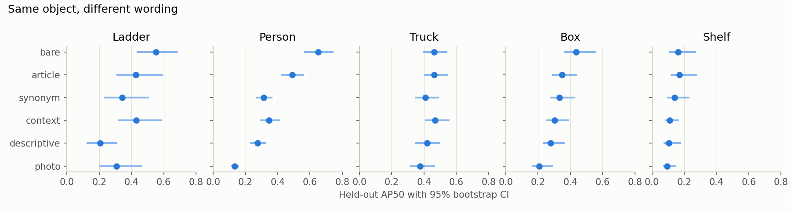
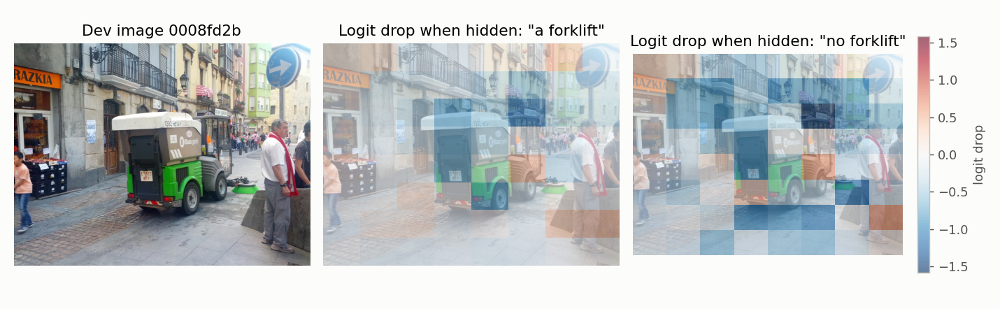
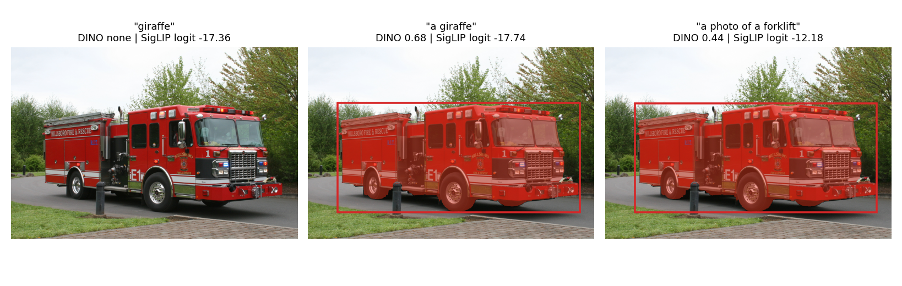
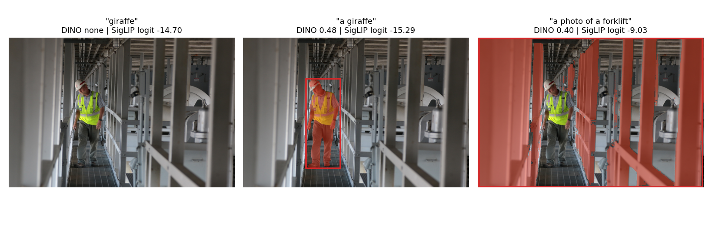
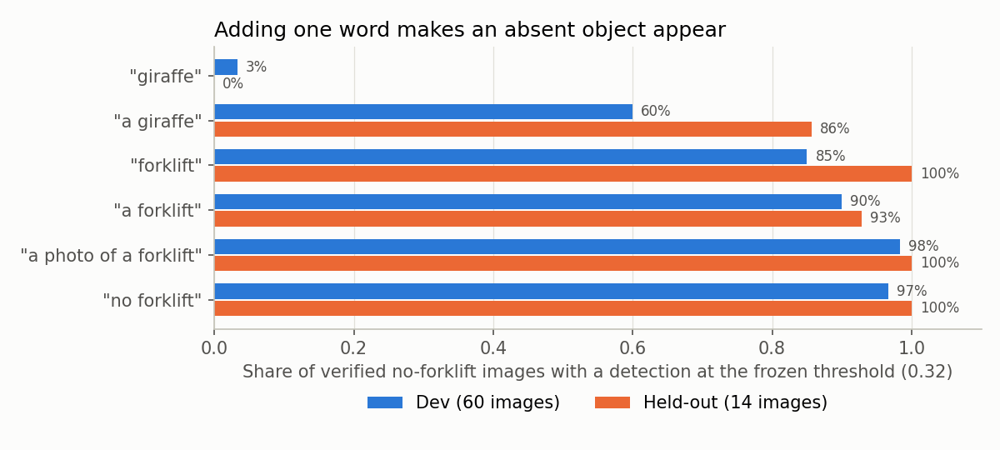
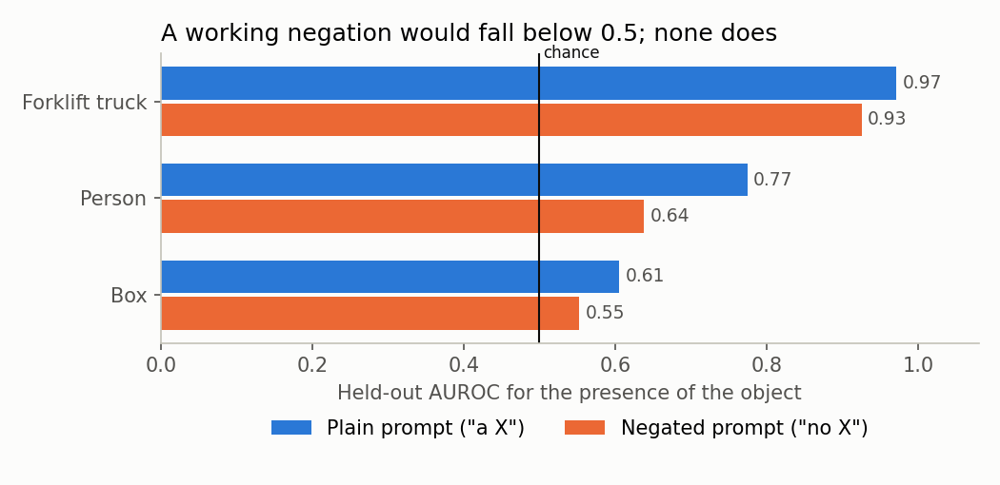
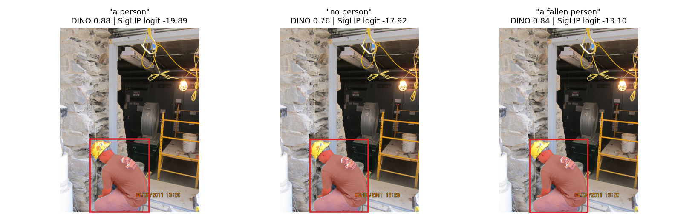

# Results and Failure Analysis

For the decision-maker summary, risk register and deployment questions, see [EVALUATION.md](EVALUATION.md). This document holds the detailed methods and results.

All held-out numbers come from choices frozen on dev data (`docs/results/selection.json`): SigLIP condition `photo`, detector condition `bare`, detector threshold 0.32. Confidence intervals are 95% bootstrap intervals over images. Raw tables are in `docs/results/`.

**Summary.** The pipeline works end to end, but it is not usable as a safety function. SigLIP ranks some scene-level concepts well (forklift AUROC 0.97). The detector localizes people, ladders, trucks, and boxes moderately (AP50 0.44 to 0.65) and shelves poorly (0.16). Its largest problem is that it almost never stays silent: at the frozen threshold it fired on 100% of held-out images verified to contain no forklift (14 images; 95% interval 78% to 100%), and "a giraffe" fired on 86% of them (60% to 96%) (giraffe absence assumed, not verified; ten other unrelated nouns fired on 78% of dev images on average, Section 7). A pre-registered test on fresh images found that a SigLIP presence check cuts false detections but loses too much recall to adopt (Section 8).

## 1. Evaluation data

| | Images | Source |
| --- | --- | --- |
| Dev | 1,562 | Open Images V7 train |
| Held-out before exclusions | 2,120 | V7 test and validation |
| Excluded for sharing a photographer with dev | 415 (310 test, 105 validation) | `leakage_exclusions.csv` |
| Held-out evaluated | 1,705 | |

Negatives are human-verified, but they come from machine-proposed candidates. They are hard negatives at an artificial prevalence, so AUROC and precision here do not predict performance in a real warehouse feed.

## 2. Zero-shot image-level results (held-out)

Baselines: chance is AUROC 0.50, and the prompt baseline is the plain `article` wording ("a forklift"). The SigLIP condition was frozen as `photo`.

| Class | Positive / negative | SigLIP `photo` AUROC [95% CI] | SigLIP `article` | Detector `bare` AUROC [95% CI] |
| --- | --- | --- | --- | --- |
| Forklift truck | 25 / 14 | **0.971** [0.922, 1.000] | 0.971 | 0.669 [0.473, 0.836] |
| Shelving | 121 / 52 | **0.934** [0.890, 0.969] | 0.933 | 0.491 [0.398, 0.592] |
| Hard hat | 17 / 22 | **0.896** [0.775, 0.984] | 0.928 | 0.424 [0.235, 0.608] |
| Warehouse | 30 / 65 | **0.796** [0.669, 0.902] | 0.814 | 0.519 [0.395, 0.644] |
| Inventory | 31 / 72 | **0.793** [0.699, 0.878] | 0.772 | 0.467 [0.343, 0.590] |
| Shelf | 298 / 186 | **0.787** [0.746, 0.828] | 0.817 | 0.696 [0.642, 0.746] |
| Aisle | 86 / 53 | **0.767** [0.671, 0.847] | 0.742 | 0.680 [0.584, 0.766] |
| Person | 420 / 532 | 0.763 [0.732, 0.792] | 0.774 | **0.967** [0.956, 0.976] |
| Truck | 122 / 136 | **0.711** [0.647, 0.772] | 0.717 | 0.555 [0.480, 0.624] |
| Box | 185 / 125 | 0.604 [0.542, 0.666] | 0.605 | 0.605 [0.542, 0.672] |
| Ladder | 117 / 106 | 0.495 [0.419, 0.567] | 0.518 | **0.726** [0.660, 0.792] |
| Cardboard | 126 / 22 | 0.356 [0.259, 0.456] | 0.411 | 0.431 [0.303, 0.556] |

Bold marks the higher point estimate of the two frozen models, not a significant difference. Ties and classes where neither model beats chance are unmarked. Small classes have wide intervals.

Two results are unresolved. Cardboard is significantly **below** chance (0.71 on dev), and Ladder fell from 0.72 on dev to 0.50 on held-out. Neither cause is established, but one observation is consistent with a shift between the dev and held-out sources: the 60 held-out Ladder images excluded for sharing a photographer with dev score 0.66, against 0.49 for the kept images (`audit_exclusion_sensitivity.csv`). Dev comes from the Open Images train split and held-out from validation and test, which may also differ in how labels were produced; I did not verify that. Either way, choices tuned on dev may transfer worse than the dev numbers suggest, which Section 8 also found.

## 3. Detection results (held-out)

| Class | Images | AP50 `bare` [95% CI] | AP50 `article` | Paired difference [95% CI] |
| --- | --- | --- | --- | --- |
| Person | 941 | 0.651 [0.561, 0.746] | 0.490 | +0.161 [+0.128, +0.195] |
| Ladder | 152 | 0.553 [0.433, 0.687] | 0.428 | +0.125 [+0.041, +0.185] |
| Truck | 252 | 0.463 [0.392, 0.545] | 0.462 | +0.001 [-0.065, +0.060] |
| Box | 217 | 0.435 [0.360, 0.561] | 0.348 | +0.087 [+0.032, +0.153] |
| Shelf | 438 | 0.161 [0.107, 0.274] | 0.169 | -0.008 [-0.027, +0.009] |
| **Mean** | | **0.452** | 0.379 | |

Person boxes include the child classes Man, Woman, Boy and Girl. An earlier version of this table counted only boxes labeled Person itself, which understated Person AP50 (0.570) and dropped 25 held-out images with only child-class boxes; the other four classes have no child classes and are unchanged (`audit_ap_hierarchy.csv`). Forklift, the project's central object, has no box labels in the evaluated data, so it has no AP50.

### Operating point at the frozen threshold (held-out, image level)

| Class | Precision | Recall | False positive rate |
| --- | --- | --- | --- |
| Person | 0.777 | 0.971 | 0.220 |
| Ladder | 0.646 | 0.795 | 0.481 |
| Box | 0.622 | 0.881 | 0.792 |
| Shelf | 0.661 | 0.980 | 0.806 |
| Truck | 0.483 | 0.943 | 0.904 |
| Shelving | 0.700 | 0.926 | 0.923 |
| Aisle | 0.622 | 0.977 | 0.962 |
| Inventory | 0.297 | 0.968 | 0.986 |
| Cardboard | 0.848 | 0.976 | 1.000 |
| Forklift truck | 0.641 | 1.000 | 1.000 |
| Hard hat | 0.436 | 1.000 | 1.000 |
| Warehouse | 0.316 | 1.000 | 1.000 |

The threshold was a single value chosen for pooled dev F1, which rewards firing nearly always on data with this many positives. Per-class thresholds chosen on dev barely help: in an exploratory held-out check (`audit_mitigations_exploratory.csv`) the false positive rate stays at 92% or higher for 8 of 12 classes, and only Ladder (48% to 25%) and Person (22% to 15%) improve noticeably, both at a cost in recall. The detector's scores do not separate absent from present well enough for any single threshold to fix this.

## 4. Prompt variation as an experimental variable

| Mean across classes (held-out) | `bare` | `article` | `synonym` | `context` | `descriptive` | `photo` | `ensemble` |
| --- | --- | --- | --- | --- | --- | --- | --- |
| Detector AP50 (5 classes) | **0.452** | 0.379 | 0.307 | 0.331 | 0.256 | 0.223 | n/a |
| Detector image AUROC (12 classes) | **0.603** | 0.573 | 0.541 | 0.539 | 0.525 | 0.458 | n/a |
| SigLIP AUROC (12 classes) | 0.745 | **0.750** | 0.677 | 0.726 | 0.691 | 0.739 | 0.744 |

- **The detector is highly sensitive to wording.** For Person, AP50 ranges from 0.651 (`person`) to 0.132 (`a photo of a person`) for the same images. Dev selected `bare`, and held-out confirmed it.
- **SigLIP is less sensitive, and dev tuning did not help it.** `photo` won on dev by a small margin, but on held-out it does not beat the plain baseline. Its paired difference is below zero for Cardboard, Ladder, and Shelf, and its confidence interval includes zero for the other nine classes. The commonly recommended template gave no measurable benefit here.
- **More words did not mean better results.** `descriptive` prompts were among the worst for both models.

## 5. Segmentation and rescoring

SAM mask IoU is measured against held-out ground-truth masks. Prompting with the ground-truth box gives an upper bound on what the detector can reach.

| Class | Instances | SAM with ground-truth box | SAM with detected box | Instances with no box at IoU ≥ 0.5 |
| --- | --- | --- | --- | --- |
| Truck | 117 | 0.894 | 0.744 | 15.4% |
| Box | 140 | 0.839 | 0.670 | 25.7% |
| Person | 40 | 0.765 | 0.720 | 5.0% |

The gap to the upper bound comes mostly from detection, not SAM. Detections are matched to ground-truth instances one-to-one within each image, so one box over two objects counts once (an earlier version paired each instance with its best-overlapping detection, which was optimistic: Box 0.678 and 23.6%). Person has 40 instances from 37 images (12 before child-class masks were included), still too few to rely on.

**SigLIP rescoring of masked crops was not adopted.** Crops are scored with SigLIP's own frozen `photo` wording. On dev, geometric-mean fusion was mixed and small: slightly higher than the detector for Box (0.529 vs 0.500) and Ladder (0.803 vs 0.794), lower for Person (0.530 vs 0.618), Shelf (0.278 vs 0.298) and Truck (0.473 vs 0.519). On held-out it was higher for Box (0.524 vs 0.428) and Truck (0.507 vs 0.463), and lower for Person, Shelf, and Ladder. Dev gives no consistent case for it, and no uncertainty was computed for these figures. This comparison keeps only each image's top 10 detections, which lowers detector AP where scenes are crowded (Person 0.582 vs 0.651 in Section 3).

## 6. How contrastive pretraining links text to image regions

Both models are trained to pull matching text and image representations together, but only one of them has a region to link.

**SigLIP has no text-to-region link.** It pools the image into one vector and scores `logit = t · cos(image, text) + b`. Pairwise sigmoid loss treats each image-text pair as an independent yes/no decision ([documentation](https://huggingface.co/docs/transformers/model_doc/siglip)). A region can only influence the score by changing the pooled vector. Occlusion maps are consistent with this: maps for "a forklift" and "no forklift" have a median correlation of 0.66 across 20 dev images, so the two prompts depend on largely the same regions. The figure below is a single illustration, not evidence on its own.

This image is verified as a forklift in Open Images, but it shows a street sweeper. Because it is mislabeled, the earlier claim drawn from it, that hiding parts of the vehicle raises the score, says nothing about forklifts and has been withdrawn.

**Grounding DINO links regions to individual tokens.** Text and image features pass through cross-attention, then each object query is compared to every caption token by a dot product. Training pushes each query toward the tokens of the phrase describing its object. The final confidence is the **highest sigmoid across all tokens**.

**Why that produces the observed prompt sensitivity:**

1. **Every token competes.** The detection score is a maximum, so any token can claim a region, including one with no object meaning. Measured on images with no forklift, the top detection for "a giraffe" was won by the token "a" in 98% of dev cases and 100% of held-out cases.
2. **Context changes the word.** Fusion means a token's features depend on its neighbors. Even counting only the noun tokens, "a giraffe" fires on 40% of dev images against 3% for "giraffe". Removing "a" from the scoring therefore doesn't fully undo its effect.
3. **Contrastive training rewards relative matching.** Nothing in these losses asks the model to represent logic. A negative caption such as "no box" is mostly the same tokens as "a box" (SigLIP text cosine 0.83) and is rarely a training target.

Points 1 and 2 are measured here. Why the token "a" behaves like generic objectness is an inference: pretraining phrases such as "a man" likely mark the determiner as part of positive spans, but I did not inspect the training data.

## 7. Failure Analysis

Failure modes were found on dev data, then measured on held-out data with the same frozen probes. Held-out forklift negatives number only 14, so those rates are imprecise. Each example was reproduced in three fresh single-image calls and gave identical results (`docs/results/reproductions.json`).

### Failure mode 1: Function words create detections of absent objects

**(a) Condition.** A prompt containing an article or template, on an image that does not contain the object.

| Prompt, on verified no-forklift images (giraffe absence assumed, not verified) | False detection, dev (n=60) | Held-out (n=14) | Token "a" or other structural token wins, dev / held-out |
| --- | --- | --- | --- |
| "giraffe" | 3% | 0% | 0% / 0% |
| "a giraffe" | 60% | 86% | 98% / 100% |
| "a photo of a forklift" | 98% | 100% | 65% / 57% |

The same token pattern appears on verified no-box images: for "a photo of a box", 93% (dev) and 88% (held-out) of top detections are won by structural tokens.

**Control nouns.** "Giraffe" is not a verified-absent label: the images are verified to have no forklift, and giraffes were assumed absent. To check that the result is not specific to one noun, ten more nouns unrelated to industrial scenes were tested on the same 60 dev no-forklift images (`validation_control_nouns.csv`). With an article they fired on 78% of images on average (range 62% to 95%), against 30% without one. The article effect holds for eight of the ten nouns. It does not for "lighthouse" (95% vs 93%), "snowman" (88% vs 90%) and "kangaroo" (75% vs 73%), which fire about as often bare, so removing the article is not a general fix. Absence of these objects is also assumed, not verified, though it is very likely in these images.

**(b) Example.** Image `046c751beec3d33a` shows a fire truck. "giraffe" returns nothing above threshold, while "a giraffe" boxes and segments the truck at 0.68. Image `00ccb23f94265963` shows a worker on a walkway. "a giraffe" segments the worker at 0.48, and "a photo of a forklift" selects nearly the whole frame at 0.40.

**(c) Root cause.** The mechanism in Section 6: the score is a maximum over all tokens, and the determiner has learned something close to generic objectness. Any salient object can then match "a" strongly, whatever noun follows it.

**(d) Mitigation.**
- Strip determiners and templates from detector prompts. This is measured here and is the frozen `bare` condition. It is the cheapest and largest improvement, but it only addresses this failure mode (see failure mode 3).
- Score only content tokens (exploratory, designed after held-out results were seen). Measured partial effect: for "a photo of a box", false detections fall from 87% to 25% on dev and from 95% to 40% on held-out, but "a giraffe" still fires on 40% and 36%, because of the context effect.
- With more time, add control prompts such as nonsense nouns to every query and only accept a detection that beats its control. Also evaluate this over a larger set of absent-object prompts.

### Failure mode 2: Negation and object state are ignored

**(a) Condition.** A prompt that negates the object or specifies its state, on images containing that object. This matters directly for this project, because hazard prompts such as "fallen package" depend on the modifier.

| Prompt (held-out images containing the object) | Fires | Same top box as plain prompt (IoU ≥ 0.9) | Mean score change |
| --- | --- | --- | --- |
| "no forklift" (n=25) | 100% | 100% | -0.018 |
| "not a forklift" (n=25) | 100% | 100% | +0.008 |
| "no box" (n=60) | 97% | 88% | -0.024 |
| "not a box" (n=60) | 98% | 92% | +0.028 |
| "a fallen box" (n=60) | 98% | 83% | -0.018 |
| "a damaged box" (n=60) | 97% | 85% | -0.026 |
| "no person" (n=60) | 90% | 60% | -0.051 |
| "a fallen person" (n=60) | 95% | 58% | +0.003 |

SigLIP behaves similarly. A working "no forklift" prompt would have AUROC below 0.5 for forklift presence, but it scores 0.93 against 0.97 for "a forklift". Its logits correlate 0.94 with the plain prompt across images. The negation does lower SigLIP's absolute score (mean probability on positives 0.386 to 0.028), so the words have an effect, but the image ranking is largely preserved.

**(b) Example.** Image `00a1c9247cf3e24c` shows a crouching worker. "a person", "no person", and "a fallen person" all return essentially the same box and mask, at 0.88, 0.76, and 0.84. SigLIP rates "a fallen person" *above* "a person" on this worker, who has not fallen (logit -13.1 vs -19.9).

**(c) Root cause.** On no-forklift and no-box images, a noun token wins the top detection for "no forklift" or "no box" in 85% of dev cases (102 of 120) and 95% of held-out cases (70 of 74). The token "no" wins the rest, and those are still positive detections rather than rejections. Max-over-tokens has no way for one token to reverse another. Both losses learn co-occurrence between text and image, and captions rarely describe what is absent, so there is little pressure to learn logical composition.

**(d) Mitigation.**
- Never put negation in a prompt. Query the positive term and apply "absent" as logic after detection.
- Treat object state as a separate classification problem. Fallen packages, damaged cartons, and blocked aisles have **no labels in Open Images**, so accuracy for them is unmeasured and this PoC makes no claim about them. With more resources I would collect labeled warehouse images and train a state classifier on detected crops. The planned LoRA stage is the natural place for this, using dev data only.
- Add negated and state-swapped captions as hard negatives during any text-encoder adaptation.

### Failure mode 3: The detector cannot reject lookalikes or scene-level concepts

**(a) Condition.** The prompted class is absent but something visually related is present, or the concept is a scene or material rather than a discrete object. Removing the article doesn't fix this: "forklift" still fires on 85% of dev and 100% of held-out no-forklift images.

| Class (held-out) | Detector `bare` AUROC | SigLIP `photo` AUROC | Detector false positive rate |
| --- | --- | --- | --- |
| Forklift truck | 0.669 | 0.971 | 100% |
| Shelving | 0.491 | 0.934 | 92% |
| Hard hat | 0.424 | 0.896 | 100% |
| Warehouse | 0.519 | 0.796 | 100% |

**(b) Example.** In Figure 1 of failure mode 1 above, the fire truck is boxed by "a photo of a forklift" at 0.44, while SigLIP gives the same image and prompt a logit of -12.2. The false positive rates above show this is typical, not isolated.

**(c) Root cause.** Partly established and partly inference. The evidence is that SigLIP separates the same images well, so the information exists in the image and the failure is specific to the detector's score. The likely cause is that the detector picks the best-matching queries from each image and its per-token score is not calibrated as an absolute probability of presence. The negatives are also deliberately difficult: they were machine-proposed candidates that humans rejected. Crop rescoring was tested and did not fix this on dev.

**(d) Mitigation.**
- Use a two-stage cascade: SigLIP gates scene-level presence, then the detector localizes only when the gate passes. An exploratory held-out check suggested large gains for some classes (Forklift truck false positive rate 100% to 29% at recall 0.96), but it was designed after held-out results were seen. The pre-registered test on unused images (Section 8) does not support adopting it: the gain is real for Person and Shelf but costs more recall than allowed, and for Truck it is too small to matter.
- Per-class thresholds were checked and barely help (Section 3).
- With more resources, collect warehouse-specific hard negatives and fine-tune on them. Forklift box labels are also needed so localization can be measured at all.

## 8. Pre-registered test of the SigLIP presence check

This is the one confirmatory test added by the review. The rules in `configs/gate.yaml` were fixed before any fresh image was chosen or scored.

**Design.** The check passes a detector firing only if SigLIP's `photo` logit for the image is at or above a per-class cut. Each cut is the highest logit that keeps 95% of dev positives, frozen in `gate_selection.json` from dev data alone. Fresh images are verified Open Images labels from the validation and test splits that no earlier step used, from photographers who appear nowhere in dev or held-out, and with no near-duplicates of earlier images (none were found). Only Person, Shelf and Truck still have enough unused verified negatives. **Deviation from the stated design:** the per-class sample cap of 300 was applied when choosing images, but each chosen image keeps all its verified labels (as in the main manifest), so final counts exceed the cap (Person 545 positives) and each class's sample is enriched with images chosen for the other two classes. The test was not rerun, because rerunning would no longer be a single confirmatory run. The check is adopted for a class only if the drop in false positive rate has a 95% interval above zero (Bonferroni-corrected for three classes) **and** the point loss in recall stays within a pre-set limit (Person 5 points, Shelf and Truck 10 points), both against the detector alone at the frozen threshold 0.32.

| Class (fresh images) | Positive / negative | False positive rate, detector → with check | Drop [95% CI] | Recall, detector → with check | Recall loss [95% CI] | Limit | Adopt |
| --- | --- | --- | --- | --- | --- | --- | --- |
| Person | 545 / 548 | 31.9% → 19.7% | 12.2 [9.1, 15.5] | 97.1% → 81.5% | 15.6 [11.8, 19.7] | 5 | No |
| Shelf | 301 / 223 | 80.3% → 59.6% | 20.6 [14.0, 27.3] | 95.7% → 80.7% | 15.0 [10.2, 20.5] | 10 | No |
| Truck | 302 / 252 | 94.4% → 89.7% | 4.8 [2.0, 8.0] | 96.0% → 92.1% | 4.0 [1.5, 6.8] | 10 | Yes |

All figures are percentage points, from `gate_fresh_test.csv`.

- **The check does remove false positives,** significantly for all three classes. For Person and Shelf the cut set on dev lost about 15 points of recall on fresh images, far more than the 5 points its 95% dev recall floor implied, so it fails the recall rule. The dev cut does not transfer.
- **Truck passes the rule, but the gain is too small to use.** The detector still fires on 90% of fresh no-truck images with the check in place.
- **AP50 does not improve.** Removing all detections from images that fail the check lowers AP50 for Person (0.751 → 0.620, difference [-0.188, -0.090]) and Truck (0.548 → 0.526, [-0.046, -0.002]), and leaves Shelf unchanged (0.110 → 0.119, [-0.010, +0.027]).
- **Forklift could not be tested.** No unused verified forklift negatives exist. Applying the frozen cut to the 14 reused held-out negatives lowers the false positive rate from 100% to 64% at unchanged recall (`gate_reused_heldout_nonconfirmatory.csv`). This is not confirmatory, and it is much weaker than the 29% the exploratory check reported.

**Conclusion.** A SigLIP presence check with a dev-set cut is not an adequate fix for failure mode 3. Its trade-off between false positives and recall varies from class to class and does not carry over from dev to fresh data.

## 9. Limitations

- **No warehouse-representative test set.** Open Images is general Flickr photography, and only part of it resembles a warehouse.
- **Unmeasured targets.** Wooden pallet: 10 dev positives, no held-out labels. Forklift localization: no box labels. Fallen package, damaged carton, blocked aisle: not in the dataset.
- **Label noise.** Verified positives include visibly wrong labels, such as the street sweeper in Section 6. I did not measure the rate.
- **Assumed absence.** Absent-object tests use nouns such as "giraffe" whose absence was assumed, not verified.
- **Exploratory analyses.** Tables added after held-out results were first seen are exploratory and are labeled so: the per-class threshold and SigLIP gate check (`audit_mitigations_exploratory.csv`), the content-token scoring figures in failure mode 1, and the control-noun test. They suggest directions; they do not confirm them.
- **Multiple comparisons.** With 12 classes and 7 conditions, some differences will look significant by chance. Confidence intervals are not corrected.
- **Precision and quantization.** All results use fp16 autocast on the GPU. Against fp32, this changes detector scores by at most 0.012 and SigLIP logits by at most 0.034, flipping 0.5% to 0.7% of presence-check decisions. Dynamic int8 quantization is not safe for this system as configured: SigLIP AUROC is unchanged, but logits move by a median of about 1 and up to 9.3, which flips 9% to 11% of presence-check decisions at the frozen cuts (`validation_siglip_precision_gate.csv`). Any absolute threshold must be re-derived after quantization, on dev data. The int8 detector check covers only 40 images and one prompt, and SAM was not checked at all.
- **Reduced resolution.** Detector input of 480/800 was chosen to fit the GPU and may reduce scores against published settings.
- **Not implemented.** LoRA adaptation, edge optimization, robustness testing, and the safety assessor remain documented stubs.

This is a research proof of concept. It must not be used as a safety function, and the results here argue against relying on zero-shot prompting alone for hazard detection.
